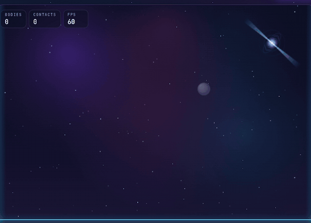

# Orbital 🪐

**Two physics engines, written from scratch in plain JavaScript.**
No Box2D. No Matter.js. No dependencies. No build step.

I wanted to know how physics engines actually work, so I stopped using one and wrote my own.

### 👉 [Try it live](https://orbital-physics-engine.vercel.app)



---

## Two toys in one

### 🧱 Rigid body mode
A box full of stuff you can throw around.

- Crates, orbs, triangles, pentagons and hexagons
- Stack them, knock a pyramid over, or grab a shape with your mouse (or finger) and fling it
- Crank gravity up to Jupiter, or switch to zero-G and watch everything float

### 🌌 Orbital mode
A tiny solar system sandbox.

- Launch planets and watch them crash and merge
- Switch between **Euler**, **Verlet** and **RK4** to see which one slowly falls apart
- A live energy graph lets you literally watch Euler cheat
- Try the **figure-8 preset**: three stars chasing each other in a loop. It's weirdly satisfying.

### Controls

| Key     | Action                |
| ------- | --------------------- |
| `Space` | Pause                 |
| `S`     | Slow-mo               |
| `N`     | Step one frame        |

---

## What's under the hood

| | Rigid body | Orbital |
| --- | --- | --- |
| **Collisions** | SAT (Separating Axis Theorem) | Merge on contact |
| **Solver / integrator** | Sequential impulses with warm starting, friction and bounciness | Euler, Verlet, RK4 |
| **Scaling** | Spatial hash (no all-pairs checks) | Barnes-Hut once there are lots of bodies |

Both run on a **fixed 240 Hz timestep**, so a pyramid settles the same way every time.

## Steal the engines

The engines never touch the DOM, so you can drop them into your own project:

```js
import {create} from './src/rigid/index.js';

const world = create();
world.reset();
for (let i = 0; i < 240; i++) world.step(); // one second of physics
console.log(world.bodies.length);
```

## Run it locally

Browsers won't load ES modules from a `file://` page, so you need a tiny server:

```bash
git clone https://github.com/skibidin4than/orbital-physics-engine.git
cd orbital-physics-engine
npm start
```

Then open http://localhost:8000.

## Tests

```bash
npm test   # Node 18+
```

They check things like boxes coming to rest, fast objects not tunneling through the floor, and Barnes-Hut agreeing with brute force.

## Heads up

The code is compact. I went for short and fast over pretty, so some of it reads like a puzzle. This is a learning project, not a replacement for a real engine.

## License

MIT. Do whatever you want. See [LICENSE](LICENSE).
